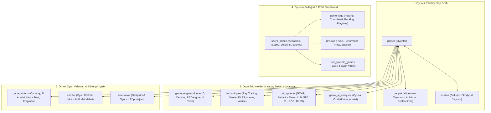

# 🛠️ GamePL — Mimari Tasarım ve Uygulama Planı (`implementation_plan.md`)

**Tarih:** 31 Ekim 2026  
**Hedef Dizin:** `/var/www/gamepl`  
**Önerilen Veritabanı:** MySQL (`gamepl_db`)  
**Mimari Referans:** `/var/www/sine` (Cinema Culture v2.0 mimarisinin dijital oyun, oyun motorları ve yapay zekâ alanına genişletilmiş üst versiyonu)

---

## 1. Sistem Mimarisi ve Temel Modüller



---

## 2. Veritabanı Şeması (MySQL `gamepl_db`)

### 2.1 Oyun Motorları ve Oyun Teknolojileri (`game_engines` & `technologies`)
Oyunların arkasındaki mühendisliği görünür kılmak için her oyun bir **Oyun Motoru (`game_engine_id`)** ve birden fazla **Oyun Teknolojisi (`technologies`)** ile ilişkilendirilir:

```sql
CREATE TABLE game_engines (
    id BIGINT UNSIGNED AUTO_INCREMENT PRIMARY KEY,
    name VARCHAR(150) NOT NULL,          -- Örn: 'Unreal Engine 5', 'Decima', 'REDengine 4', 'id Tech 7'
    slug VARCHAR(150) NOT NULL UNIQUE,
    developer VARCHAR(150) NULL,         -- Örn: 'Epic Games', 'Guerrilla Games', 'CD Projekt RED'
    programming_languages VARCHAR(150) NULL, -- Örn: 'C++, Blueprint', 'C#, HLSL'
    rendering_features TEXT NULL,        -- Örn: 'Nanite Sanal Geometri, Lumen Küresel Aydınlatma'
    description TEXT NULL,
    logo_url VARCHAR(255) NULL,
    created_at TIMESTAMP NULL,
    updated_at TIMESTAMP NULL
);

CREATE TABLE technologies (
    id BIGINT UNSIGNED AUTO_INCREMENT PRIMARY KEY,
    name VARCHAR(150) NOT NULL,          -- Örn: 'Path Tracing', 'NVIDIA DLSS 3.5', 'Havok Physics', 'Wwise Audio'
    slug VARCHAR(150) NOT NULL UNIQUE,
    category ENUM(
        'rendering',      -- Ray Tracing, Path Tracing, Lumen, Global Illumination
        'upscaling_ai',   -- DLSS, FSR, XeSS, Ray Reconstruction
        'physics',        -- Havok, PhysX, Chaos Physics, Euphoria
        'audio',          -- Wwise, FMOD, Dolby Atmos, Tempest 3D
        'graphics_api',   -- DirectX 12 Ultimate, Vulkan, Metal
        'networking'      -- Rollback Netcode, Server Meshing
    ) NOT NULL,
    description TEXT NULL,
    created_at TIMESTAMP NULL,
    updated_at TIMESTAMP NULL
);
```

### 2.2 Oyun Teknolojileri ve Yapay Zekâ İlişkisi (`ai_systems` & `game_ai_analyses`)
Platformun en ayırt edici modülü olan **Oyun Teknolojileri ve AI İlişkisi**, hem kuramsal AI mimarilerini (`ai_systems`) hem de bu mimarilerin oyunlarda nasıl uygulandığını anlatan vaka analizlerini (`game_ai_analyses`) barındırır:

```sql
CREATE TABLE ai_systems (
    id BIGINT UNSIGNED AUTO_INCREMENT PRIMARY KEY,
    name VARCHAR(180) NOT NULL,          -- Örn: 'GOAP (Goal-Oriented Action Planning)', 'Director AI', 'Nemesis System', 'Neural Frame Generation'
    slug VARCHAR(180) NOT NULL UNIQUE,
    domain ENUM(
        'npc_decision',       -- FSM, Behavior Trees, GOAP, Utility AI, HTN (Hierarchical Task Networks)
        'dynamic_world',      -- Director AI (Left 4 Dead), Nemesis System, Living Ecosystem AI
        'procedural_gen',     -- PCG (Prosedürel Gezegen/Zindan/Biyom Üretimi), Wave Function Collapse
        'neural_graphics',    -- DLSS, Sinirsel Doku Sıkıştırma, AI Ray Reconstruction
        'generative_npc',     -- LLM Tabanlı Diyalog, NVIDIA ACE, Inworld AI, Ses Sentezi
        'animation_physics',  -- AI Motion Matching, Sinirsel Ragdoll / Euphoria
        'reinforcement_learning' -- OpenAI Five, GT Sophy, RL Bot Eğitimi
    ) NOT NULL,
    summary TEXT NOT NULL,               -- Kısa teknik tanım
    technical_explanation LONGTEXT NOT NULL, -- Algoritmanın çalışma prensibi, avantajları ve CPU/GPU maliyeti
    created_at TIMESTAMP NULL,
    updated_at TIMESTAMP NULL
);

CREATE TABLE game_ai_analyses (
    id BIGINT UNSIGNED AUTO_INCREMENT PRIMARY KEY,
    game_id BIGINT UNSIGNED NOT NULL,
    ai_system_id BIGINT UNSIGNED NOT NULL,
    user_id BIGINT UNSIGNED NULL,        -- Analizi yazan Geliştirici / Editör
    title VARCHAR(255) NOT NULL,         -- Örn: 'F.E.A.R. Düşman Yapay Zekâsı: GOAP ile Dinamik Kuşatma Taktikleri'
    slug VARCHAR(255) NOT NULL UNIQUE,
    implementation_details LONGTEXT NOT NULL, -- Oyunda bu AI tekniğinin nasıl kodlandığı ve oyuncuya etkisi
    pros_and_cons TEXT NULL,             -- Güçlü yönler ve sınırlar
    video_url VARCHAR(255) NULL,         -- AI davranışını gösteren örnek analiz videosu
    status VARCHAR(20) DEFAULT 'approved' INDEX, -- pending, approved, rejected
    approved_by BIGINT UNSIGNED NULL,
    created_at TIMESTAMP NULL,
    updated_at TIMESTAMP NULL,
    FOREIGN KEY (game_id) REFERENCES games(id) ON DELETE CASCADE,
    FOREIGN KEY (ai_system_id) REFERENCES ai_systems(id) ON DELETE CASCADE
);
```

### 2.3 Oyunlar, Yaratıcı Ekip ve Örnek Oyun Videoları (`games`, `game_person`, `game_videos`)

```sql
CREATE TABLE games (
    id BIGINT UNSIGNED AUTO_INCREMENT PRIMARY KEY,
    igdb_id BIGINT UNSIGNED NULL UNIQUE,
    title VARCHAR(255) NOT NULL,
    original_title VARCHAR(255) NULL,
    slug VARCHAR(255) NOT NULL UNIQUE,
    release_year SMALLINT UNSIGNED NOT NULL,
    average_playtime_hours SMALLINT UNSIGNED NULL, -- Örn: 45 saat
    developer_studio VARCHAR(200) NOT NULL,        -- Örn: 'Larian Studios', 'CD Projekt RED', 'FromSoftware'
    publisher VARCHAR(200) NULL,
    director VARCHAR(255) NULL,                    -- Örn: 'Swen Vincke', 'Hideo Kojima', 'Hidetaka Miyazaki'
    lead_designer VARCHAR(255) NULL,
    composer VARCHAR(255) NULL,                    -- Örn: 'Borislav Slavov', 'Gustavo Santaolalla'
    cast TEXT NULL,                                -- Örn: 'Neil Newbon (Astarion), Troy Baker (Joel Miller)'
    genre VARCHAR(150) NOT NULL,                   -- Örn: 'CRPG', 'Action RPG', 'Immersive Sim', 'Sci-Fi Survival'
    platforms VARCHAR(255) NOT NULL,               -- Örn: 'PC, PS5, Xbox Series X/S'
    game_engine_id BIGINT UNSIGNED NULL,
    cover_url VARCHAR(255) NULL,
    backdrop_url VARCHAR(255) NULL,
    trailer_url VARCHAR(255) NULL,
    description LONGTEXT NOT NULL,
    technical_notes TEXT NULL,                     -- Kare hızı, Ray Tracing, DLSS/FSR ve optimizasyon özeti
    is_game_of_the_day BOOLEAN DEFAULT FALSE INDEX,
    curator_pitch TEXT NULL,
    status VARCHAR(20) DEFAULT 'approved' INDEX,
    created_by BIGINT UNSIGNED NULL,
    approved_by BIGINT UNSIGNED NULL,
    translations JSON NULL,                        -- 7 dilde (TR, EN, FR, DE, ES, IT, JA) başlık ve açıklama
    created_at TIMESTAMP NULL,
    updated_at TIMESTAMP NULL,
    FOREIGN KEY (game_engine_id) REFERENCES game_engines(id) ON DELETE SET NULL
);

CREATE TABLE game_videos (
    id BIGINT UNSIGNED AUTO_INCREMENT PRIMARY KEY,
    game_id BIGINT UNSIGNED NOT NULL,
    user_id BIGINT UNSIGNED NULL,
    title VARCHAR(255) NOT NULL,
    video_type ENUM(
        'gameplay_showcase', -- Saf Oynanış Kesiti (Örnek Oyun Videosu)
        'ai_behavior_demo',  -- Yapay Zekâ & NPC Davranış Analizi Videosu
        'tech_breakdown',    -- Motor, Ray Tracing & Performans Analizi (Digital Foundry tarzı)
        'developer_diary',   -- Geliştirici Günlüğü & Kamera Arkası
        'official_trailer'   -- Resmi Fragman
    ) DEFAULT 'gameplay_showcase',
    video_url VARCHAR(255) NOT NULL,               -- YouTube / Vimeo / MP4 URL
    duration_seconds SMALLINT UNSIGNED NULL,
    highlight_timestamp VARCHAR(20) NULL,          -- Örn: '04:15 - GOAP AI Pusuya Yatırma Anı'
    description TEXT NULL,
    status VARCHAR(20) DEFAULT 'approved' INDEX,
    created_at TIMESTAMP NULL,
    updated_at TIMESTAMP NULL,
    FOREIGN KEY (game_id) REFERENCES games(id) ON DELETE CASCADE
);
```

### 2.4 Oyuncu Belleği, Günlük ve İncelemeler (`game_logs`, `reviews`)

```sql
CREATE TABLE game_logs (
    id BIGINT UNSIGNED AUTO_INCREMENT PRIMARY KEY,
    user_id BIGINT UNSIGNED NOT NULL,
    game_id BIGINT UNSIGNED NOT NULL,
    play_status ENUM('playing', 'completed', 'backlog', 'dropped', 'mastered') DEFAULT 'playing',
    platform_played VARCHAR(50) NULL,              -- 'PC (RTX 4080)', 'PS5', 'Steam Deck'
    hours_played SMALLINT UNSIGNED DEFAULT 0,
    completed_at DATE NULL,
    liked BOOLEAN DEFAULT FALSE,
    created_at TIMESTAMP NULL,
    updated_at TIMESTAMP NULL,
    UNIQUE KEY unique_user_game_log (user_id, game_id),
    FOREIGN KEY (user_id) REFERENCES users(id) ON DELETE CASCADE,
    FOREIGN KEY (game_id) REFERENCES games(id) ON DELETE CASCADE
);
```

---

## 3. Örnek Veri Seti: Oyunlar, Oyun Teknolojileri ve AI Vaka Analizleri

Seeder (`DatabaseSeeder.php`) ile başlangıçta yüklenecek gerçek oyunlar, oyun motorları ve AI incelemeleri:

| Oyun | Oyun Motoru | Öne Çıkan Teknolojiler | Oyun & Yapay Zekâ (AI) Vaka Analizi | Örnek Video Türleri |
| :--- | :--- | :--- | :--- | :--- |
| **Baldur's Gate 3** *(Larian Studios, 2023)* | Divinity 4.0 Engine | Vulkan, DLSS, Dinamik Diyalog Kamerası | **Utility AI & Taktiksel Savaş Değerlendiricisi:** NPC'lerin çevre etkileşimlerini, yükseklik avantajını ve büyü kombinasyonlarını ağırlıklı fayda fonksiyonlarıyla hesaplaması. | Oynanış Kesiti + Taktiksel AI Analizi |
| **Cyberpunk 2077: Phantom Liberty** *(CD Projekt RED, 2023)* | REDengine 4 | Full Path Tracing (Ray Tracing Overdrive), DLSS 3.5 Ray Reconstruction | **Sinirsel Render (Neural Rendering) & Kalabalık AI:** Yapay zekâ destekli ışın yeniden inşası (Ray Reconstruction) ve şehir içi otonom yaya/trafik tepki ağları. | Path Tracing & DLSS 3.5 Teknik Analiz Videosu |
| **Red Dead Redemption 2** *(Rockstar Games, 2018)* | RAGE (Rockstar Advanced Game Engine) | Euphoria Sinirsel Fizik, Hacimsel Bulut/Sis | **Yaşayan Ekosistem & Bağlamsal NPC Hafızası:** Kasaba halkının oyuncunun geçmiş eylemlerini hatırlaması, hayvan besin zinciri simülasyonu ve Euphoria fizik-AI entegrasyonu. | Ekosistem & NPC AI Davranış Videosu |
| **F.E.A.R.** *(Monolith, 2005)* | LithTech Jupiter EX | Dinamik Hacimsel Gölgeler, Parçacık Fiziği | **GOAP (Goal-Oriented Action Planning) Devrimi:** Düşman askerlerinin önceden yazılmış script'ler yerine anlık hedef planlamasıyla masa devirip siper alması ve oyuncuyu arkadan kuşatması. | Klasik GOAP AI Karşılaştırma Videosu |
| **Alien: Isolation** *(Creative Assembly, 2014)* | Cathode Engine | Gerçek Zamanlı Aydınlatma, Binaural Ses | **İki Katmanlı Yapay Zekâ (Director AI + Xenomorph Brain):** Oyuncunun konumunu bilen ancak ipucu veren "Yönetmen AI" ile oyuncunun alışkanlıklarını öğrenen "Yaratık Davranış Ağacı (Behavior Tree)" mimarisi. | Çift Katmanlı AI Analiz Videosu |
| **Middle-earth: Shadow of Mordor / War** *(Monolith, 2017)* | Firebird Engine | Prosedürel Karakter Üretimi | **Nemesis Sistemi (Prosedürel Sosyal Hiyerarşi AI):** Oyuncuyu öldüren sıradan bir düşmanın rütbe atlaması, önceki karşılaşmalardaki yara izlerini ve diyalogları hatırlaması. | Nemesis Sistemi Örnek Oynanış Videosu |
| **No Man's Sky** *(Hello Games, 2016–2026)* | Özel Prosedürel Motor | Vulkan, Voxel Geometri, DLSS | **Deterministik Prosedürel Gezegen & Biyom Üretimi (PCG):** 18 kentilyon gezegenin matematiksel tohum (seed) fonksiyonları ve yapay zekâ destekli yaratık anatomisiyle anlık üretilmesi. | Prosedürel Evren & Motor Videosu |
| **The Last of Us Part II** *(Naughty Dog, 2020)* | Naughty Dog Proprietary Engine | **Motion Matching (AI Animasyon)**, 3D Ses | **Motion Matching & Koordineli Grup Avı AI:** Düşmanların birbirine isimleriyle seslenerek köpeklerle iz sürmesi ve binlerce animasyon karesi arasından yapay zekâ ile en akıcı geçişin seçilmesi. | Motion Matching & Grup AI Oynanış Videosu |
| **Alan Wake 2** *(Remedy, 2023)* | Northlight Engine | Mesh Shaders, Path Tracing, Wwise | **Northlight Motorunda Mesh Shading ve Atmosferik Gerilim Yönetimi:** Modern GPU mimarisinde geometri işleme ve ses/ışık tabanlı dinamik gerilim temposu. | Northlight Motoru Teknik İnceleme Videosu |
| **Elden Ring** *(FromSoftware, 2022)* | FromSoftware Engine | Özel Fizik & Animasyon Hitbox Sistemi | **Girdi Okuma (Input Reading) ve Gecikmeli Saldırı Durum Makineleri (HFSM):** Boss tasarımlarında oyuncunun iyileşme veya yuvarlanma reflekslerini ölçen hiyerarşik durum makineleri. | Boss AI & Hitbox Analiz Videosu |

---

## 4. Sayfa ve Rota Mimarisi (`routes/web.php` & `routes/api.php`)

### 4.1 Web Rotaları
1. **`GET /` (`home`)**:
   - **🌟 Günün Oyunu & AI Vitrini** (Oyun afişi, motoru, kullandığı AI tekniği ve küratörün "Neden Oynamalı & Teknik Önemi" notu).
   - **🧠 Oyun Teknolojileri ve Yapay Zekâ Laboratuvarı Özeti** (*GOAP, Behavior Trees, Path Tracing, DLSS, Nemesis Sistemi, PCG* kartları).
   - **🎬 Öne Çıkan Örnek Oyun & Teknik Analiz Videoları** (Sayfa içi Lightbox oynatıcı ile).
   - **🕹️ Keşif Motoru**: Oyun Motoruna göre (`?engine=unreal-engine-5`), AI Tekniğine göre (`?ai=goap`), Teknolojisine göre (`?tech=path-tracing`), Döneme göre (`?decade=2020`) ve Puana göre (`?sort=rating_desc`) filtreleme + sayfalama.
2. **`GET /games/{game:slug}` (`games.show`)**:
   - Oyun künyesi, ortalama oynanış süresi (`45 saat`), platformlar, Bayesian ağırlıklı puan ve 1–10 puan histogramı.
   - **⚙️ Oyun Motoru & Teknoloji Künyesi Kartı**: Tıklanabilir Oyun Motoru (`/engines/{slug}`), Grafik/Fizik/Ses teknolojileri (`/technologies/{slug}`).
   - **🧠 Bu Oyunda Kullanılan Yapay Zekâ Mimarisi**: Oyunun AI vaka analizi (`game_ai_analyses`) ve algoritmik şeması.
   - **🎬 Örnek Oyun Videoları Galerisi**: *Oynanış Kesiti*, *AI Davranış Analizi* ve *Motor Performans Testi* videolarını sayfa içi sinema modunda izleme.
   - **👥 Yaratıcı Ekip & Seslendirme Kadrosu**: Oyun yönetmeni, baş tasarımcı, besteci ve seslendirme sanatçıları (`Karakter Adı` ile birlikte `/people/{slug}` bağlantılı).
   - **🎙️ Geliştirici Röportajları & ✒️ Oyun/Teknoloji Yazıları**.
   - **Oyuncu Kontrolleri**: `🎮 Oynuyorum`, `🏆 Bitirdim`, `📌 Backlog (İstek Listesi)` butonları ve spoiler korumalı inceleme formu.
3. **`GET /ai-lab` & `GET /ai-lab/{aiSystem:slug}` (`ai.index`, `ai.show`)**:
   - **Oyun Teknolojileri ve Yapay Zekâ İlişkisi Özel Bölümü**:
     - Klasik Oyun AI (*FSM, Behavior Trees, GOAP, Utility AI*) ile Modern/Üretken AI (*DLSS/Sinirsel Render, LLM NPC, Pekiştirmeli Öğrenme, PCG*) arasındaki evrimi anlatan interaktif rehber.
     - İlgili AI tekniğini kullanan tüm oyunların ve örnek analiz videolarının listesi.
4. **`GET /engines/{engine:slug}` (`engines.show`)**:
   - Oyun motorunun teknik özellikleri ve o motorla geliştirilmiş tüm oyunlar.
4.5 **`GET /hardware` & `GET /hardware/{hardware:slug}` (`hardware.index`, `hardware.show`)**:
   - **Teknik Oyun Araçları, En İyi Monitörler, Oyun Konsolları ve AI Donanımları Rehberi (`gaming_hardware`)**:
     - Kategori bazlı filtreleme (`monitor` — 4K QD-OLED & 540Hz E-Spor Monitörleri, `console` — PS5 Pro PSSR, Steam Deck OLED, Xbox Series X, `gpu_ai` — RTX 4090 Tensor/Path Tracing, `vr_headset` — Valve Index / Quest 3, `peripherals` — Wooting 80HE Hall-Effect & DualSense Edge).
     - Teknik spesifikasyon tablosu (`key_specs`), oyun motorları ve yapay zekâ (DLSS 3.5, PSSR, Frame Gen) sinerjisi, artılar/eksiler, tanıtım videosu ve bu donanımı test etmek için önerilen oyunlar (`game_gaming_hardware`).
5. **`GET /videos` (`videos.index`)**:
   - Türüne göre filtrelenebilir (*Oynanış Kesitleri, AI Analiz Videoları, Motor Karşılaştırmaları, Geliştirici Söyleşileri*) video kütüphanesi.
6. **`GET /articles` & `GET /interviews`**:
   - Oyun kültürü, oyun tasarımı ve teknoloji makaleleri ile geliştirici/oyuncu röportajları (otomatik Soru-Cevap `Q&A` bloklarıyla).
7. **`GET /dashboard` (`dashboard`)**:
   - 5 role (`admin`, `webadmin`, `studyo`, `gelistirici`, `oyuncu`) özel içerik giriş ve moderasyon paneli:
     - Yeni Oyun & Teknik Künye Ekleme (`studyo`, `gelistirici`, `webadmin`, `admin`)
     - Yeni **Oyun & AI Vaka Analizi (`Game AI Case Study`)** Ekleme (`gelistirici`, `webadmin`, `admin`)
     - Yeni **Örnek Oyun / Teknik Analiz Videosu** Ekleme (`studyo`, `gelistirici`, `webadmin`, `admin`)
     - Yeni Oyun/Teknoloji Makalesi & Röportaj Ekleme
     - Onay Bekleyen İçerikler Moderasyon Kuyruğu (`webadmin`, `admin`)
     - Kullanıcı Rol Yönetimi (`admin`)
8. **`GET /profile` & `GET /users/{member}`**:
   - Oyuncunun *Oynuyor / Bitirdi / Backlog* günlüğü, toplam oyun süresi, **🌟 Favori 4 Oyun Vitrini** ve takipçi sistemi.

---

## 5. Uygulama Fazları (Adım Adım Yol Haritası)

| Faz | Kapsam | Çıktılar |
| :--- | :--- | :--- |
| **Faz 1: Temel Kurulum & Veritabanı** | `/var/www/gamepl` içinde Laravel 13 + Tailwind v4 kurulumu, MySQL `gamepl_db` bağlantısı ve tüm tabloların (`games`, `game_engines`, `technologies`, `ai_systems`, `game_ai_analyses`, `game_videos`, `people`, `users`, `reviews`, `articles`, `interviews`) göç dosyaları. | Çalışan veritabanı şeması ve Eloquent modelleri |
| **Faz 2: Oyun Teknolojileri & AI Veri Beslemesi (Seeder)** | 15+ gerçek kült/modern oyun, 8 oyun motoru, 12 oyun teknolojisi, 8 kapsamlı **Oyun & AI Vaka Analizi**, örnek oynanış/AI analiz videoları, geliştirici röportajları ve 7 dilde çevirilerin seed edilmesi. | Zengin, gerçekçi ve çok dilli başlangıç verisi |
| **Faz 3: Ana Sayfa, Oyun Detay & Video Laboratuvarı** | Günün Oyunu vitrini, Keşif Motoru (Motor/AI/Dönem filtreli), Oyun Detay Sayfası (Teknik künye + AI analizi + Sinema Modu Örnek Video Oynatıcı) ve `/videos` galerisi. | Tam etkileşimli önyüz ve video oynatıcı |
| **Faz 4: "Oyun Teknolojileri ve AI İlişkisi" (`/ai-lab`) & Motor Sayfaları** | Oyunlarda yapay zekânın karar alma, prosedürel üretim ve sinirsel grafik boyutlarını inceleyen `/ai-lab` merkezi ve `/engines/{slug}` sayfaları. | Platformun imzası olan Teknoloji & AI modülü |
| **Faz 5: 5 Rollü Dashboard, Röportajlar & Makaleler** | `admin`, `webadmin`, `studyo`, `gelistirici`, `oyuncu` rolleri için Dashboard formları (Oyun ekleme, AI analizi ekleme, örnek video ekleme, moderasyon kuyruğu). | Rol tabanlı içerik üretim ve onay akışı |
| **Faz 6: Oyuncu Belleği, Açık Profiller & Testler** | `Playing / Completed / Backlog` günlüğü, **Favori 4 Oyun Vitrini**, `/users/{member}` profilleri ve kapsamlı PHPUnit Feature testleri. | Testleri geçmiş, yayına ve GitHub'a hazır platform |
